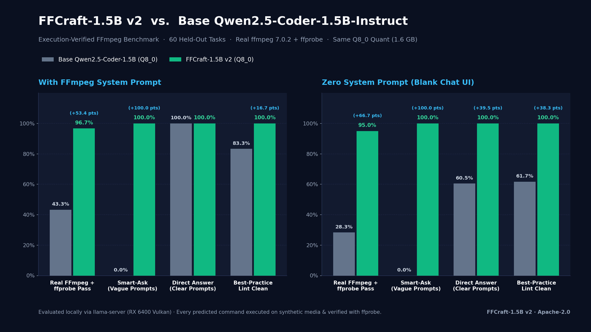

# FFCraft Studio

**1-click local desktop app for plain-English FFmpeg** — powered by [**FFCraft-1.5B**](https://huggingface.co/AKMESSI/FFCraft-1.5B-GGUF), a fine-tuned 1.5B local LLM trained on 6,000 execution-verified FFmpeg examples.

* **Zero bloat, zero dependencies:** Pure Python 3.10+ standard library + sleek dark studio UI launched in native app-window mode (no Electron, no `node_modules`, no cloud API keys).
* **Auto-`ffprobe` file inspection:** Attach any local video or audio file — FFCraft Studio reads its exact filename, duration, resolution, FPS, codecs, and file size automatically so `FFCraft-1.5B` computes exact 2-pass VBR bitrates without making you guess.
* **Adaptive clarifying questions:** Vague prompt? Asks 1–3 brief, beginner-friendly questions first. Clear prompt? Gives the optimal FFmpeg command immediately.
* **1-click Copy or 1-click Run:** Run FFmpeg right inside the file's folder with a real live progress bar, Pass 1/2 indicator, **before → after file size savings**, and a **Show in Folder** button.
* **1-click Model Setup:** If `ffcraft-1.5b-v2.Q8_0.gguf` (1.6 GB) isn't on disk yet, FFCraft Studio downloads it straight from Hugging Face inside the app and starts `llama-server` automatically.

---

## Quickstart (1-Click Launch)

### Prerequisites
1. **Python 3.10+**
2. **FFmpeg** (`ffmpeg` + `ffprobe` on PATH)
3. **`llama.cpp`** (`llama-server` on PATH):
   * **Windows:** `winget install ggml.llamacpp`
   * **macOS:** `brew install llama.cpp`

### Launch
```bash
git clone https://github.com/AKMessi/ffcraft-studio.git
cd ffcraft-studio
```

* **Windows:** Double-click **`FFCraft.bat`** (or run `python run.py`)
* **macOS / Linux:** Run `./ffcraft.sh` (or `python3 run.py`)

On first launch, click **Download Model (1.6 GB)** if you don't already have [`ffcraft-1.5b-v2.Q8_0.gguf`](https://huggingface.co/AKMESSI/FFCraft-1.5B-GGUF) locally — or drop an existing copy into `models/` (or set `FFCRAFT_MODEL_PATH`).

---

## Model Benchmark (`FFCraft-1.5B` v2 vs. Base `Qwen2.5-Coder-1.5B-Instruct`)



Evaluated on 60 held-out real-world tasks with real `ffmpeg 7.0.2` + `ffprobe` execution (same `Q8_0` quant):

| Metric | Base (With Sys) | **FFCraft-1.5B v2 (With Sys)** | Base (Zero Sys) | **FFCraft-1.5B v2 (Zero Sys)** |
|---|---:|---:|---:|---:|
| **Real `ffmpeg` + `ffprobe` Pass** | 43.3% | **96.7%** (+53.4) | 28.3% | **95.0%** (+66.7) |
| **Smart-Ask Rate** *(vague prompts)* | 0.0% | **100.0%** (+100) | 0.0% | **100.0%** (+100) |
| **Direct-Answer Rate** *(clear prompts)* | 100.0% | **100.0%** | 60.5% | **100.0%** (+39.5) |
| **Best-Practice Lint Clean** | 83.3% | **100.0%** (+16.7) | 61.7% | **100.0%** (+38.3) |

Model weights: **[`AKMESSI/FFCraft-1.5B-GGUF`](https://huggingface.co/AKMESSI/FFCraft-1.5B-GGUF)** (Apache-2.0)

---

## Environment Variables (Optional)
* `FFCRAFT_MODEL_PATH` — Custom path to any `.gguf` file.
* `FFCRAFT_API_URL` — Point at an already-running OpenAI-compatible server (e.g., `http://127.0.0.1:11434/v1` for Ollama) instead of auto-launching `llama-server`.
* `FFCRAFT_PORT` — Custom UI port (default `8765`).

---

## License
Apache-2.0 — see [`LICENSE`](LICENSE).
